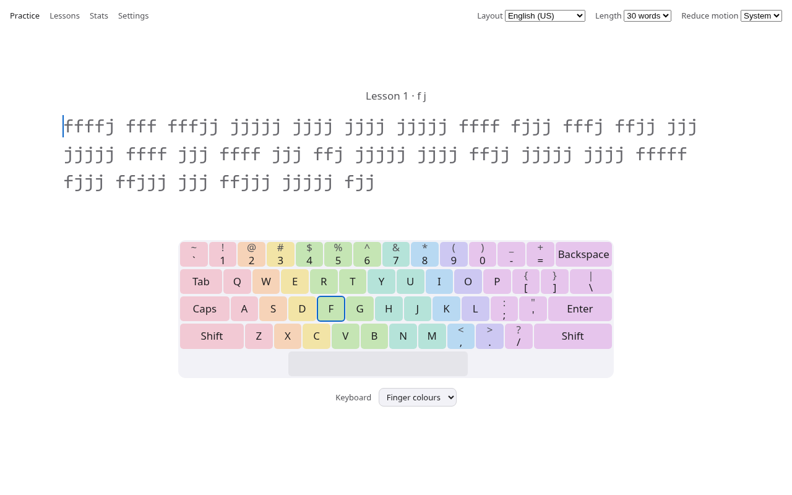

# Qwerniop

A calm, fast touch-typing trainer that runs in any modern browser.

Qwerniop teaches ten-finger typing step by step: it starts on the home row, adds keys as you master them, and keeps drilling the keys you miss. It works fully offline. An optional local language model can generate practice text, teach you a topic while you type, or give feedback on a session.

<picture>
  <source media="(prefers-color-scheme: dark)" srcset="docs/screenshots/practice-dark.png">
  
</picture>

> Status: in development. See [the roadmap](docs/ROADMAP.md).

## Features

- Step-by-step lessons that unlock keys as your accuracy and speed improve
- On-screen keyboard showing which finger presses each key
- Adaptive drills weighted toward your weakest keys
- US QWERTY and Czech QWERTZ layouts, including dead keys (háček, čárka)
- Practice content: words, punctuation and capitals, numbers, code
- Two error modes: stop on error, or continue with Backspace
- Stats and history stored locally, with JSON export and import
- Light and dark appearance following your system
- Installable and usable offline
- Optional: connect any OpenAI-compatible model server (Ollama, LM Studio, llama.cpp) for generated lessons, topic learning, code snippets and session feedback

Nothing leaves your computer unless you configure a model server yourself.

## Running locally

Requirements: Node.js 22 or newer and pnpm.

```sh
pnpm install
pnpm dev        # development server
pnpm build      # production build into dist/
pnpm preview    # serve the production build
```

Open the address shown in the terminal. Any static file server works for `dist/`.

## Optional: local model server

Qwerniop talks to any server that implements the OpenAI chat completions API. With Ollama:

```sh
# allow the app's origin to call Ollama from the browser
OLLAMA_ORIGINS="http://localhost:5173,http://localhost:4173" ollama serve
ollama pull <model>
```

Then open Settings → Model server, keep the default address `http://localhost:11434/v1`, pick a model, and press "Test connection". See [docs/AI.md](docs/AI.md).

## Documentation

- [Architecture](docs/ARCHITECTURE.md)
- [Layouts, fingers and lessons](docs/LAYOUTS.md)
- [Design](docs/DESIGN.md)
- [Performance](docs/PERFORMANCE.md)
- [Model integration](docs/AI.md)
- [Code style](docs/CODE_STYLE.md)
- [Roadmap](docs/ROADMAP.md)
- [Changelog](CHANGELOG.md)
- [Contributing](CONTRIBUTING.md)

## License

[MIT](LICENSE)

Word lists are derived from the Leipzig Corpora Collection (CC BY), and the bundled font is JetBrains Mono (SIL OFL 1.1). Full credits are in [src/data/SOURCES.md](src/data/SOURCES.md).
